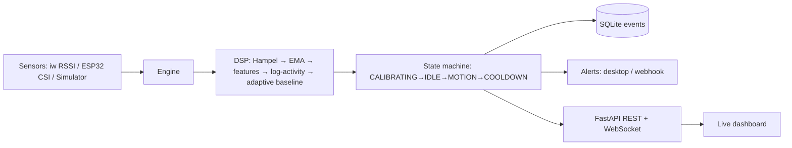

# 📡 E-Home Radar

Professional, local-first **Wi-Fi based device-free motion detection**. Uses ambient
radio signals from your own Wi-Fi link to detect presence and movement — no camera,
no cloud, no root. Runs on a standard Linux laptop; optionally upgrades to
ESP32 **CSI** for much higher sensitivity.

## Overview & Architecture

Full docs: [Plan](docs/01-PROJECT-PLAN.md) · [Architecture](docs/02-ARCHITECTURE.md) ·
[Algorithms](docs/03-ALGORITHMS.md) · [Operations](docs/04-OPERATIONS.md) · [Testing](docs/05-TESTING.md)

Inspired by open-source work: [espectre](https://github.com/francescopace/espectre),
[esp-csi](https://github.com/espressif/esp-csi),
[ESP32-CSI-Tool](https://github.com/StevenMHernandez/ESP32-CSI-Tool),
[nexmon_csi](https://github.com/nexmonster/nexmon_csi).

## Prerequisites
Linux with a Wi-Fi interface, `iw`, `ping`, Python ≥ 3.10 (optional: `notify-send`).

## Installation
```bash
git clone https://github.com/Mohamedsalem-fn/E-Home-Radar && cd E-Home-Radar
./deploy/install.sh            # add --service for systemd user service
```

## Usage
```bash
.venv/bin/ehome-radar doctor
.venv/bin/ehome-radar run              # dashboard: http://127.0.0.1:8787
.venv/bin/ehome-radar run --sim        # no hardware demo
.venv/bin/ehome-radar export events > events.csv
.venv/bin/pytest -q
```
Keep the room still for the first 20 s (calibration), then move around.
See [Operations](docs/04-OPERATIONS.md) for the API reference, config and troubleshooting.

## Configuration
Copy `config.example.yaml` → `config.yaml` (sensor kind, profile, alerts, storage).

## Credits / Author
Designed and developed by **Mohamed Salem** — Expert AI Engineer & Automation Architect
(AI Engineering · Automation · LLMs · Agentic Systems · MLOps).
