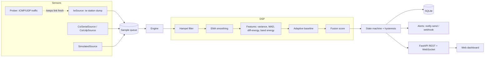

# 02 — Architecture

> Author: Mohamed Salem — Expert AI Engineer & Automation Architect

## Data flow


## Package layout
```
src/ehome_radar/
  models.py        Sample, Reading, Event dataclasses
  config.py        YAML/ENV config with validation
  sensors/         base, iw, csi, simulator, prober
  dsp/             filters, features, baseline, detector
  engine.py        orchestrates sensor→dsp→state→sinks
  storage.py       SQLite repository (WAL)
  alerts.py        notification sinks
  server.py        FastAPI app + WebSocket + static dashboard
  cli.py           command line entry
  web/index.html   dashboard (canvas, no CDN)
tests/             pytest suite
deploy/            systemd unit, install script
docs/              this documentation
```

## Key design choices
- **Pluggable sensors** share one `Sensor` protocol yielding `Sample(ts, values)`;
  `values` is a vector (1 element for RSSI, N subcarriers for CSI).
- **Detector is sensor-agnostic**: works on a per-sample scalar "activity" derived
  from the vector (mean-abs deviation across subcarriers, or the RSSI itself).
- **Thread model**: sensor thread → thread-safe queue → engine thread; FastAPI
  async loop reads engine snapshots, broadcasts over WebSocket at ~5 Hz.
- **Local-only** by default (`127.0.0.1:8787`).

